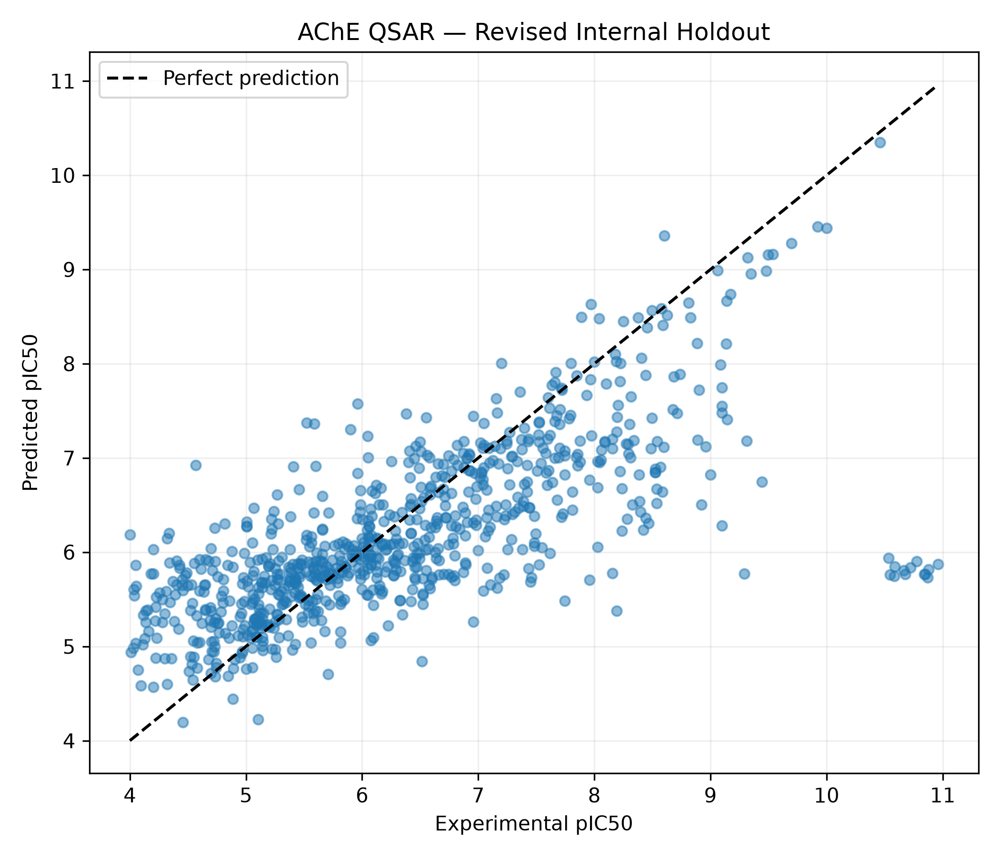
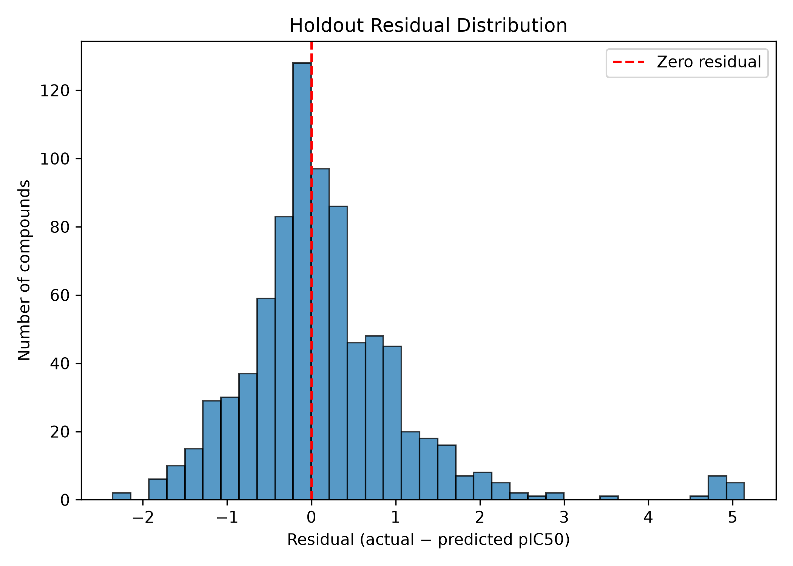

# Scaffold-Aware QSAR Modeling of Human Acetylcholinesterase Inhibitors

**Research portfolio project \| Python · RDKit · scikit-learn · ChEMBL**

This project investigates quantitative structure–activity relationships
(QSAR) for human acetylcholinesterase (AChE) inhibition using
provisionally curated ChEMBL IC50 measurements. It emphasizes
**chemical-scaffold-aware validation**, stereochemical representation,
and transparent analysis of prediction failures rather than maximizing a
single performance metric.

> **Research status:** Exploratory retrospective modeling study. The
> curated dataset is provisional, and the revised internal holdout is
> **not** an independent external or prospective validation set.
> Predictions should not be used to make experimental or clinical
> decisions.

## Research question

How reliably can classical QSAR and machine-learning regression predict
human AChE inhibitory potency for compounds with previously unseen
achiral Bemis–Murcko scaffolds? What role do structural representations
and concentrated prediction errors play in interpreting model
performance?

## Data and curation

- **Target:** Human acetylcholinesterase, ChEMBL target `CHEMBL220`
  (UniProt `P22303`).
- **Initial retrieval:** 10,079 IC50 activity records.
- **Exact numerical IC50 in nM:** 7,275 records after initial filtering.
- **Final provisional dataset:** 3,644 unique standardized compounds
  following assay screening, structure standardization, conflict
  filtering, and median aggregation of eligible repeated measurements.
- **Endpoint:** `pIC50 = 9 − log10(IC50 [nM])`.

Molecular structures were processed using RDKit cleanup and
fragment-parent standardization. Assay selection and conflict filtering
were provisional; **the original publications and assay provenance have
not all been independently verified**. No compounds were removed solely
because their model predictions were inaccurate.

## Molecular representations

- **Eight RDKit descriptors:** molecular weight, LogP, TPSA, HBD, HBA,
  rotatable bonds, ring count, and fraction Csp3.
- **Morgan fingerprints:** radius 2, 2,048 bits.
- **Chirality-aware Morgan fingerprints:** radius 2, 2,048 bits, with
  chirality enabled.
- **Selected representation:** 2,048 chirality-aware fingerprint bits +
  eight descriptors (2,056 features).

## Evaluation design

The revised dataset split uses
`GroupShuffleSplit(test_size=0.20, random_state=42)` with **achiral
Bemis–Murcko scaffolds** as groups:

| Partition                | Compounds |
|:-------------------------|----------:|
| Revised training         |     2,830 |
| Revised internal holdout |       814 |
| Total                    |     3,644 |

No achiral Bemis–Murcko scaffold or identical non-isomeric molecular
connectivity representation was shared between these two revised
partitions. Model comparisons used **five-fold achiral-scaffold
GroupKFold cross-validation** within the revised training set.

**Important validation qualification:** Earlier exploratory experiments
examined the same underlying dataset, including a prior train/test
split. Therefore, the revised holdout is a useful internal diagnostic,
but it does **not** restore a fully untouched, independent test set. The
reported CV performance is also exploratory rather than a nested-CV
estimate of the entire model-selection process.

## Main results

| Model and features                                   | Evaluation               |        R² | RMSE (pIC50) | MAE (pIC50) |
|:-----------------------------------------------------|:-------------------------|----------:|-------------:|------------:|
| **Extra Trees + chiral Morgan + 8 descriptors**      | 5-fold scaffold CV       | **0.575** |    **0.803** |   **0.596** |
| **Extra Trees + chiral Morgan + 8 descriptors**      | Revised internal holdout | **0.481** |    **1.011** |   **0.670** |
| Multiple linear regression + 8 descriptors           | 5-fold scaffold CV       |     0.164 |        1.126 |       0.908 |
| Partial least squares (6 components) + 8 descriptors | 5-fold scaffold CV       |     0.162 |        1.127 |       0.908 |

Additional exploratory benchmarks included Random Forest, SVR, k-nearest
neighbors, Ridge, XGBoost, LightGBM, and CatBoost. The classical
regression baselines used only eight physicochemical descriptors, so
differences versus Extra Trees reflect **both model choice and feature
representation**, not algorithm effects in isolation.

The selected Extra Trees configuration used `n_estimators=300`,
`max_features='sqrt'`, `min_samples_leaf=1`, `min_samples_split=2`,
`max_depth=None`, and `random_state=42`.

## Error analysis and scientific interpretation

The revised holdout scatter plot and residual histogram indicate
substantial underprediction for a small cluster of exceptionally potent
compounds. The **15 largest absolute errors (1.84% of 814 compounds)
accounted for 40.28% of the total holdout squared error**; 30 compounds
had absolute errors above 2 pIC50 units. Several highly potent compounds
share related isoquinolinone-containing motifs. Their source assay
records warrant literature-level verification before attributing the
discrepancy solely to chemistry or measurement conditions.

Earlier analyses also identified potential stereochemical activity
cliffs and structural-overlap issues in a chirality-aware scaffold
split. These observations motivated the revised achiral scaffold
grouping. They should not be interpreted as independently verified
experimental mechanisms.

**Interpretation:** Performance is moderate under this internal
scaffold-aware evaluation, with limited generalization for some highly
potent chemical series. The model is not validated for prospective
screening or quantitative potency claims.

## Figures

<figure>

<figcaption aria-hidden="true">Experimental versus predicted pIC50 on
revised internal holdout</figcaption>
</figure>

*Figure 1. Experimental versus predicted pIC50 for 814 compounds; dashed
diagonal indicates perfect prediction.*

<figure>

<figcaption aria-hidden="true">Residual distribution on revised internal
holdout</figcaption>
</figure>

*Figure 2. Residuals defined as experimental minus predicted pIC50.*

## Public repository layout

```text
AChE_QSAR_Research/
├── README.md
├── notebooks/
│   └── AChE_QSAR_GitHub_Final.ipynb
├── data/
│   └── processed/
│       └── AChE_QSAR_provisional.csv   # Required input; publish only after provenance/licensing review
├── results/
│   ├── Publish_v2_ExtraTrees_scaffold_cv.csv
│   ├── Publish_v2_MLR_PLS_scaffold_cv.csv
│   ├── Publish_v2_holdout_metrics.csv
│   └── Publish_v2_holdout_predictions.csv  # Optional; review structure/activity disclosure first
└── figures/
    ├── Final_Actual_vs_Predicted.png
    └── Final_Residual_Distribution.png
```

This is a **proposed** layout, not confirmation that every file is approved for public distribution. The notebook needs `data/processed/AChE_QSAR_provisional.csv` with `standardized_smiles` and `pIC50` columns; if the dataset cannot be redistributed, document how an authorized user can recreate or supply it. The full exploratory notebooks, raw records, checkpoints, and trained `models/ExtraTrees_ChiralMorgan_Final_v2.joblib` (approximately 119 MB) are retained locally, not included in the proposed public repository. Do not load untrusted joblib files.

## Reproducibility

1. Create an environment with Python, `rdkit`, `numpy`, `pandas`, `scikit-learn`, `matplotlib`, and `jupyterlab`. Record the versions actually used when freezing the repository.
2. Place the provisionally curated input CSV at `data/processed/AChE_QSAR_provisional.csv`, subject to source licensing and provenance review.
3. Open `notebooks/AChE_QSAR_GitHub_Final.ipynb` from the repository root or its `notebooks/` folder, then run cells in order. It reads the existing curated CSV; it does **not** retrieve and curate ChEMBL data from scratch.
4. The notebook computes achiral-scaffold split, five-fold scaffold CV, descriptor-only MLR/PLS baselines, internal holdout metrics, figures, and error concentration. It writes the four `Publish_v2_*.csv` result files and two principal figures.
5. Compare reproduced results with the documented rounded values. The revised holdout is **internal and previously exposed during exploration**, not an independent external test.

**Reproducibility scope:** The streamlined notebook has been run successfully against the local curated dataset, with matching rounded CV and holdout metrics. End-to-end reproduction from original ChEMBL source records and assay-level provenance is **not** established. Results may depend on input data and software versions.

## Limitations and next steps

- Incomplete verification of source publications and experimental assay
  comparability.
- Retrospective model selection and reuse of the underlying dataset
  across exploratory splits.
- Possible stereochemical activity cliffs and limitations of
  fixed-length fingerprint representation.
- Uneven performance across chemical series and highly potent compounds.
- Need for genuinely external, time-split, or prospectively acquired
  data before deployment-oriented conclusions.

## Selected methodological references

1.  Bemis GW, Murcko MA. *The properties of known drugs. 1. Molecular
    frameworks.* J Med Chem. 1996;39:2887–2893.
    https://doi.org/10.1021/jm9602928
2.  Rogers D, Hahn M. *Extended-connectivity fingerprints.* J Chem Inf
    Model. 2010;50:742–754. https://doi.org/10.1021/ci100050t
3.  Geurts P, Ernst D, Wehenkel L. *Extremely randomized trees.* Machine
    Learning. 2006;63:3–42. https://doi.org/10.1007/s10994-006-6226-1
4.  ChEMBL database: https://www.ebi.ac.uk/chembl/
5.  RDKit: https://www.rdkit.org/

## Project scope

Academic research and computational chemistry portfolio. Results are
descriptive of the reported retrospective analyses; no independent
prospective validation is claimed.
